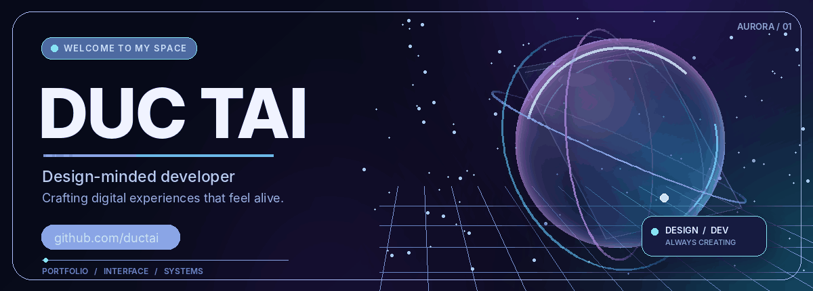
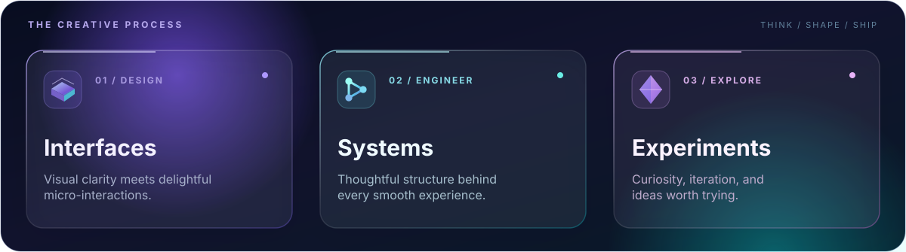

  

   
   

  
  
  

   
   

  

 

 

### `// 01 — THE PERSON BEHIND THE PIXELS`

Hi, I'm **Duc Tai** — you can find me here as [`@ductai`](https://github.com/ductai).

I'm interested in the space where **thoughtful design meets useful technology**. I enjoy exploring interfaces, building software systems, and turning rough concepts into polished digital experiences.

> **My approach:** Keep it intuitive. Make it functional. Refine the details.

### `// 02 — THE TOOLBOX`

  

Tools and technologies I'm exploring — customize this row to match your actual stack.

 

### `// 03 — GITHUB SIGNAL`

  
  

   
   

  

### `// 04 — THE NEXT CHAPTER`

  

   
   

  

   
   

  Designed to feel like a little piece of the future. · <a href="https://github.com/ductai">@ductai</a>

